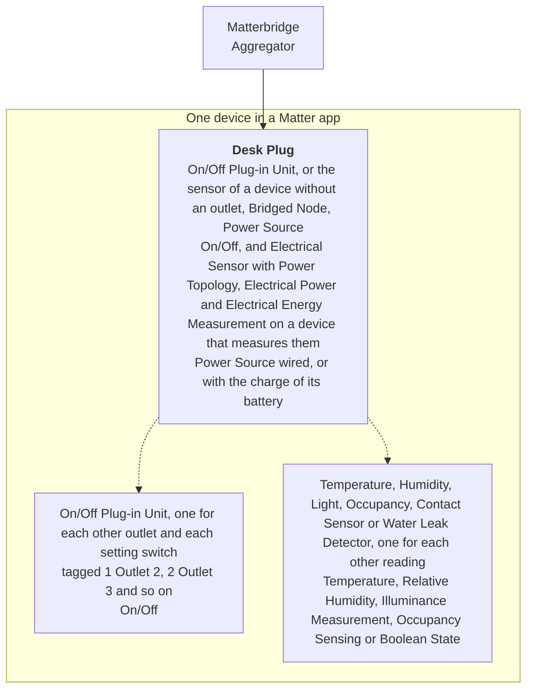

# Matterbridge Open Tuya

[](https://www.npmjs.com/package/matterbridge-open-tuya)
[](https://www.npmjs.com/package/matterbridge-open-tuya)
[](https://github.com/cheziyi/matterbridge-open-tuya/actions/workflows/build.yml)
[](https://github.com/cheziyi/matterbridge-open-tuya/actions/workflows/codeql.yml)
[](https://codecov.io/gh/cheziyi/matterbridge-open-tuya)
[](./LICENSE)

[](https://www.npmjs.com/package/matterbridge)
[](https://www.npmjs.com/package/open-tuya)

Control your Tuya smart plugs, power strips, wall switches and sensors from Apple Home, Google Home, Alexa, Home Assistant and other Matter apps.

It is a [Matterbridge](https://matterbridge.io) plugin built on [open-tuya](https://www.npmjs.com/package/open-tuya), which reaches each device on your local network first, and through the Tuya cloud when it does not answer there. It names what each device does from open-tuya's catalog of over 1,700 devices converted from [tuya-local](https://github.com/make-all/tuya-local): see its [coverage and limitations](https://github.com/cheziyi/open-tuya#coverage-and-limitations).

## Why this plugin

- **It finds your devices for you.** Sign in once in the setup page, by scanning a QR code with the Smart Life app or with a cloud project of the Tuya developer platform, and it lists every device of your account, with whether it can control each one. There is no local key, device ID or configuration file to look up: see [Guided setup](#guided-setup).
- **It talks to your devices on your network.** Each device is reached on the local network first, with the local key the cloud gives for it, which answers quicker and keeps working while the Tuya cloud or the internet is down, and through the Tuya cloud when it does not answer there: see [Connection](#connection).
- **It reaches the devices behind a gateway.** A Zigbee or Bluetooth device behind a Tuya gateway is reached through the gateway on your network, and through the cloud otherwise.
- **It offers only what your device can do.** The plugin reads what each device does from its catalog entry: each outlet of a power strip, the power and the energy of a plug that measures them, the temperature, the humidity, the light, the motion, the contact or the water leak of a sensor, its battery, and settings such as its child lock or the light of its buttons.
- **It says when a device stops answering.** After two reads in a row fail, your Matter app shows the device as unreachable, and it comes back by itself as soon as the device answers again.
- **Almost nothing needs a restart.** Sign in, add, rename, reconnect and remove devices while Matterbridge keeps running. Only a change of how a device appears in Matter waits for the next restart, which the setup page and Matterbridge ask for.

## Requirements

- Matterbridge 3.10.10 or later.
- Node.js 22.13 or later (22, 24 or 26).
- Your devices added to the Smart Life or Tuya Smart app, and one of:
  - **The Smart Life or Tuya Smart app**, to sign in by scanning a QR code. Nothing else is needed.
  - **A cloud project of the [Tuya developer platform](https://platform.tuya.com)**, with your app account linked to it under Devices > Link App Account, and its Access ID and Access Secret. Its IoT Core trial expires and has to be extended now and then.
- A route to the internet, to sign in and read the device list of the account. A device on the same network as Matterbridge is reached there, and through the Tuya cloud otherwise.

## Installation

In the Matterbridge frontend, type `matterbridge-open-tuya` in the **Install plugins** field and click **Install**, then restart Matterbridge.

From the command line instead:

```bash
npm install -g matterbridge-open-tuya
matterbridge --add matterbridge-open-tuya
```

Then set up your devices in the plugin's own page: see [Guided setup](#guided-setup).

## Guided setup

Open the plugin frontend from the plugin's row on the Matterbridge home page. The first time, it asks you to sign in, one of two ways:

- **With the Smart Life app.** Enter the User Code the app shows under Me > Settings > Account and Security > User Code. The page shows a QR code: scan it with the app, from the scan button of its home tab, and confirm the sign in there. The QR code lasts a few minutes, and the page asks for a new one once it expires. The plugin signs in with the client ID of Home Assistant's Tuya integration, the only one known to work.
- **With the Tuya developer platform.** Enter the Access ID and the Access Secret of your cloud project, and the data center it is in. The plugin lists the devices of the project before it stores it.

Then it walks through three steps:

1. **Find.** The page lists the devices of your account and marks those already set up. It says why it cannot control one: a kind of device it does not control yet, such as a light or a fan, or a gateway, whose devices are listed on their own. A device whose product the catalog does not list can still be picked: the next step reads what the Tuya cloud says of it.
2. **Connect.** For each device you picked, the plugin reads it, on your network first and through the Tuya cloud otherwise, and finds what its data points do: from the catalog entry of its product, else from the Tuya cloud's model of a plug, a power strip, a wall switch or a sensor, which names each data point by Tuya's standard codes, such as `temp_current`, else from the catalog entry that names most of the data points it reports. The model comes before that last match, which cannot tell apart two devices that report the same data points, such as a motion sensor and a water leak sensor.
3. **Options.** The name the device gets in Matter, starting from its name in the Smart Life app, which of its outlets, its sensors, its meter and its setting switches appear in Matter, and whether they are one device or several. Last, whether it is reached on your network first or through the Tuya cloud only, and a host and a protocol version for a network the plugin does not hear it on: see [Connection](#connection).

Afterwards the same page lists your devices with their status: online on your network or through the Tuya cloud, connecting, not answering, or not started, and what they last reported. From there you can add more, change the options of one, reconnect one that stopped answering, remove one, switch to another account, sign in again when the Tuya cloud no longer accepts the sign in, or sign out. Matterbridge's own list of devices shows a device added or removed here once you reload its page, named after its device ID, such as `Tuya bf1234567890abcdefgh`: the name you give it is what the Matter apps show.

## How a device appears in Matter

The plugin controls the devices whose catalog entry is a switch, a plug, a power strip or a sensor, with the lights of their buttons or their display. A light, a fan, a thermostat, a cover, a lock, a vacuum and the other kinds of the catalog are not controlled yet.

| In Matter                          | From the device                                                                                                     |
| ---------------------------------- | ------------------------------------------------------------------------------------------------------------------- |
| Outlet                             | Each switch of its main function: the plug, each outlet of a power strip, each gang of a wall switch, its USB ports |
| Electrical power and energy        | The power, the voltage, the current and the energy used so far, on the first outlet of a device that measures them  |
| Temperature sensor                 | Its temperature, in °C or °F                                                                                        |
| Humidity sensor                    | Its relative humidity                                                                                               |
| Light sensor                       | Its illuminance                                                                                                     |
| Occupancy sensor                   | The motion or the presence it detects                                                                               |
| Contact sensor                     | Whether its door or window is open                                                                                  |
| Water leak detector                | Whether it detects water                                                                                            |
| Battery                            | The charge of its battery, as the power source of the device                                                        |
| Outlet, for a setting, when chosen | Each on/off setting, such as the child lock or the light of its buttons or its display                              |

The first outlet, or the first sensor of a device without one, is the device itself: it is always there. Every other outlet and sensor, and the meter, can be left out in the options. A setting switch is left out unless you choose it.

### How it is built in Matter

Matter describes a device as endpoints. Each endpoint has one or more device types, which say what it is, and clusters, which hold its attributes and commands. Each device is one device: an endpoint for its first outlet or its first sensor, with every other outlet, sensor or setting switch as a part of it, on an endpoint of its own:



### One device or several

A device is one device in Matter by default, with its other outlets, sensors and switches as parts of it: they move between the rooms of a Matter app with it, and are unreachable when it is. Untick **Show it as one device** in its options to make each of them a device of its own, named after the device and what it is, such as `Desk Strip Outlet 2`, for a Matter app that shows the parts of a device poorly.

## Connection

Each device runs a server of its own on your network, which the Smart Life app talks to when it is on the same network. The plugin connects to it first, and to the Tuya cloud when it does not answer, as [open-tuya](https://github.com/cheziyi/open-tuya#reaching-a-device) does:

- **The discovery.** A device broadcasts its address and its protocol version every few seconds on UDP ports 6666, 6667 and 7000. The plugin listens there all the time, and follows a device its router gives a new address. It hears only the broadcasts of its own subnets: a Docker container on the default bridge network hears none, so run Matterbridge with `--network host`, or enter the host and the protocol version of the device in its options, ideally an address your router keeps for it. Another program that holds one of the ports without sharing it, such as an old tinytuya, stops the discovery: the setup page says so.
- **The local key.** The device list of the account gives the local key of each device, which encrypts its traffic on your network. It is stored with the device, never shown in the setup page, and read again from the cloud every 15 minutes, so that a device paired again in the app gets its new one.
- **The address.** The address each device was last heard at is kept across restarts, so a device is reached on your network as soon as Matterbridge starts. A device heard for the first time after it started gets its route on your network then, without a restart.
- **The fallback.** Each read and each command tries your network first, while the device is connected there, and the Tuya cloud otherwise. A command that may have reached the device, such as one that timed out, is not sent again through the cloud.
- **The gateway.** A device behind a gateway, such as a Zigbee sensor, is reached through the gateway on your network, with the gateway's local key, and through the cloud otherwise. One connection to the gateway serves every device behind it.
- **The cloud only.** A device can be set to the Tuya cloud alone in its options, for a device that is never on the network of Matterbridge.
- **Without an account.** A device keeps working on your network when you sign out, or when the Tuya cloud is down, with the local key stored for it. It needs an account again for the cloud, and to get a new local key.

The setup page shows whether each device is online on your network or through the Tuya cloud, and the log says which one it answers through when that changes.

## How devices are stored

The plugin stores the account and the devices in its own configuration, which Matterbridge keeps in its storage. The account is the session of the Smart Life sign in, which the plugin refreshes and stores again as the cloud asks, or the Access ID, the Access Secret and the data center of a cloud project. Each device is stored with its device ID, its product key, the catalog entry its controls are named by, or the Tuya cloud's model of it with its category, its local key and its options. A device stored with its model starts without the cloud. The setup page never sees the session, the secret or a local key.

A device stored by this version stays as it is when the plugin is updated: a setting added later falls back to what the plugin did before it existed. A device the plugin cannot read, such as one edited by hand, is kept in the configuration as it is, and logged.

## Configuration

The account and the devices are set up in the setup page alone. The Matterbridge config editor of the plugin has:

| Setting                | What it does                                                                                                                                                                                        |
| ---------------------- | --------------------------------------------------------------------------------------------------------------------------------------------------------------------------------------------------- |
| Poll Interval          | How often, in seconds, each device is read, from 10 to 3600: 30 by default. A device sends a change of its state by itself, so this mostly sets how soon one that is unplugged shows as unreachable |
| Enable Debug           | Logs more, for debugging                                                                                                                                                                            |
| Unregister On Shutdown | Removes every device from Matter when Matterbridge stops, for debugging                                                                                                                             |

## Good to know

- **The Smart Life session serves one program.** Two programs signed in with the same session, such as this plugin and Home Assistant with a copy of its configuration, end it for both: sign each in by a QR code of its own.
- **A device on protocol 3.1 reads under a wrong local key.** A command that times out on one is the sign that its key is wrong: read the device list again from the setup page.
- **The meter shows the first phase.** A device that measures three phases shows the readings the catalog gives for the device as a whole, or none.
- **A device that refuses a read.** Some 3.2 and 3.3 devices answer every read with an error. open-tuya can read them by writing null to their data points, which this plugin does not do, since a null write changes some devices: they are reached through the cloud instead.

## Development

The plugin is developed from the [Matterbridge plugin template](https://github.com/Luligu/matterbridge-plugin-template); see its README for the dev container and the toolchain, and [STYLEGUIDE.md](./STYLEGUIDE.md) and [AGENTS.md](./AGENTS.md) for the conventions.

```bash
npm install
npm link matterbridge        # with matterbridge installed globally
npm run build                # the plugin, into dist
npm run build:frontend       # the setup page, into apps/frontend/build (run npm install in apps/frontend and npm run build first)
npm run test:coverage
npm run lint
```

The plugin's source is in [src](./src), and its tests follow the same layout under [vitest](./vitest):

| Path                             | What it holds                                                                                                                                  |
| -------------------------------- | ---------------------------------------------------------------------------------------------------------------------------------------------- |
| [module.ts](./src/module.ts)     | The platform: the Matterbridge entry point, the account, the discovery, the gateways, the stored device list and the devices that run from it. |
| [config.ts](./src/config.ts)     | The stored configuration: its model, its validation and its comparisons.                                                                       |
| [features.ts](./src/features.ts) | What a catalog entry lets a device show in Matter: its outlets, its setting switches, its sensors, its meter and its battery.                  |
| [mapping.ts](./src/mapping.ts)   | The conversions between the values of a device and the Matter clusters.                                                                        |
| [errors.ts](./src/errors.ts)     | The helpers that describe errors.                                                                                                              |
| [accessory/](./src/accessory)    | One device in Matter: its layout, its endpoints, what the controllers ask of it and what the device reports.                                   |
| [platform/](./src/platform)      | What the platform keeps between restarts, its own saves, and the route to a device through the cloud.                                          |
| [setup/](./src/setup)            | The guided setup: the checks of a device and the REST API of the setup page.                                                                   |

The setup page is a small TypeScript page without a framework, in [apps/frontend](./apps/frontend), which esbuild bundles into one `app.js`. Matterbridge serves `apps/frontend/build` at `/plugins/matterbridge-open-tuya/`, and the page calls the plugin through `onFetch`: see [src/setup/setupApi.ts](./src/setup/setupApi.ts). The page takes the types of what the plugin sends from the plugin itself, through a TypeScript project reference to the plugin's build, which is why the plugin is built first.

## Legal disclaimer

An independent, community project for interoperability and home automation. It is not affiliated with, authorized, or endorsed by Tuya. All product names and trademarks are the property of their respective owners.

The plugin talks to the Tuya cloud with the account you sign in with, as an ordinary client of the cloud's own endpoints, and to each device on your network with the local key the cloud gives for it. Its use may be subject to Tuya's terms of service.

## License

[Apache-2.0](./LICENSE)
